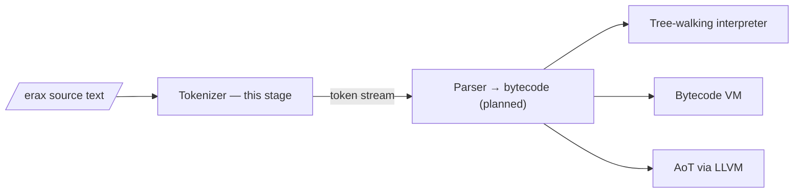
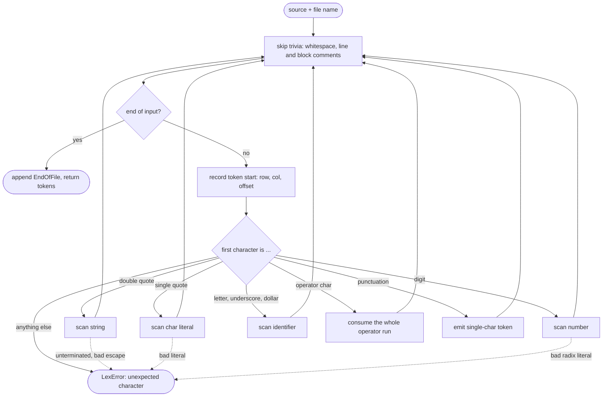
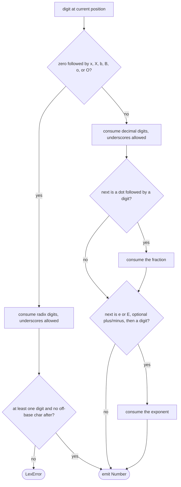

# Tokenizer

The tokenizer is stage 1 of the shared front-end. It turns raw `.erax` source text into a flat, ordered list of [tokens](#token-kinds). Everything downstream — parser, bytecode, and all three runtimes — consumes this stream, so the text and positions recorded here are the single source of truth for diagnostics.



The stage is implemented in `src/frontend/tokenizer/Tokenizer.{hpp,cpp}` and pinned by the Catch2 suite in `tests/Tokenizer.test.cpp`.

## API

```cpp
namespace erax::frontend {

enum class TokenType { /* see token kinds */ };

/// 1-indexed row/column plus 0-indexed byte offset into the source.
struct SourceLocation {
    std::string file;
    std::size_t row = 1;
    std::size_t col = 1;
    std::size_t offset = 0;
    std::string to_string() const;
};

struct Token {
    TokenType type = TokenType::EndOfFile;
    std::string text;
    SourceLocation location;

    bool operator==(const Token& other) const;
    std::string describe() const;
};

struct LexError {
    std::string message;
    SourceLocation location;
};

class Tokenizer {
public:
    using result = std::expected<std::vector<Token>, LexError>;

    /// Tokenizes `source`, appending a trailing EndOfFile token on success.
    result tokenize(std::string_view source, std::string_view file_name = {}) const;
};

}  // namespace erax::frontend
```

Behavioral contract:

- **All-or-nothing.** Either you get the complete token vector, or a `LexError`. There is no partial output, so a failed lex never leaves a half-consumed token list behind.
- **Trailing `EndOfFile`.** Every successful result ends with exactly one synthetic `EndOfFile` token positioned at the end of input. Empty input lexes to that token alone.
- **Stateless.** `tokenize` is a `const` method and the `Tokenizer` holds no state, so one instance can be shared (e.g. across threads).
- **`file_name` is recorded everywhere.** Every token and error carries the source name — the CLI passes the file path or `<stdin>`; the empty string means "anonymous".
- **Trivia is invisible but counted.** Whitespace and comments produce no tokens, yet they still advance row, column, and offset.

## Token kinds

| Kind          | Lexeme                                   | `text` example                |
| ------------- | ---------------------------------------- | ----------------------------- |
| `Identifier`  | `[A-Za-z_$][A-Za-z0-9_$]*`              | `fn`, `$el`, `a$b`, `i32`     |
| `Number`      | see [Numbers](#numbers)                  | `1_000`, `3.14`, `0xFF_FF`    |
| `String`      | `"…"`                                    | `"a\nb"` → `a\nb` (raw)       |
| `Char`        | `'…'`, exactly one character             | `'\n'` → `\n` (raw)           |
| `Operator`    | a run of `< = > \| & ^ % * / ~ + - ! ?`  | `=`, `<=`, `**`, `&&&`, `=>`  |
| `Semicolon`   | `;`                                      | `;`                           |
| `Colon`       | `:`                                      | `:`                           |
| `Comma`       | `,`                                      | `,`                           |
| `Dot`         | `.`                                      | `.`                           |
| `LParen`      | `(`                                      | `(`                           |
| `RParen`      | `)`                                      | `)`                           |
| `LBracket`    | `[`                                      | `[`                           |
| `RBracket`    | `]`                                      | `]`                           |
| `LBrace`      | `{`                                      | `{`                           |
| `RBrace`      | `}`                                      | `}`                           |
| `EndOfFile`   | (synthesized)                             | `""`                          |

Notes:

- `text` is the **exact source slice**. Quoted literals store their *inner* text with the quotes stripped and the escape sequences left raw (`"a\nb"` → the four characters `a`, `\`, `n`, `b`). Unescaping is the parser's job.
- Keywords are **not** a token kind: `fn`, `let`, `return`, … lex as plain `Identifier` and are classified by the parser.
- `Token::operator==` compares kind and text only, deliberately ignoring position, so the test suite can assert token streams without hardcoding locations.
- `Token::describe()` renders `identifier 'fn' at prog.erax:4:1` — the same format the CLI uses.

## Source locations

Every token and every error carries a `SourceLocation` with two overlapping coordinate systems:

| Field    | Convention                     | For                          |
| -------- | ------------------------------ | ---------------------------- |
| `file`   | source name, `""` if anonymous | humans, multi-file diagnostics |
| `row`    | 1-based                        | humans: error messages, editors |
| `col`    | 1-based                        | humans: error messages, editors |
| `offset` | 0-based **byte** offset of the token start | machines: slicing the source, caret math, LSP |

- Token position is the position of the **first character** of the token — for a string literal that is the opening quote, which is also where string errors are reported.
- `\r` is plain whitespace; `\n` is the only line break. CRLF therefore counts as a single newline (row +1, col reset to 1).
- Because `offset` counts every byte of the source, including trivia, `source.substr(offset, len)` always recovers the exact lexeme.

## Scanning loop



Dispatch on the first character of each token:

| First char                 | Result                                                        |
| -------------------------- | ------------------------------------------------------------- |
| space, tab, `\r`, `\n`     | skipped as trivia                                              |
| `//` or `/*`               | comment, skipped as trivia                                     |
| `"`                        | [string](#strings)                                            |
| `'`                        | [char literal](#char-literals)                                |
| `0`–`9`                    | [number](#numbers)                                            |
| letter, `_`, `$`           | [identifier](#identifiers)                                    |
| `< = > \| & ^ % * / ~ + - ! ?` | [operator run](#operators)                           |
| `; : , . ( ) [ ] { }`      | single-char punctuation token                                 |
| anything else              | `LexError: unexpected character '<c>'`                        |

Scanners are strict: the moment one fails, it sets the `LexError` and the whole run aborts. No token is emitted for the lexeme that failed.

## Lexical rules

### Trivia

- **Whitespace:** space, tab, carriage return, newline.
- **Line comments:** `//` up to (not including) the newline. A line comment at the end of input is fine.
- **Block comments:** `/* … */`, may span lines, do **not** nest. `/*/` and a missing `*/` are `unterminated block comment`.
- A `/` that is not followed by `/` or `*` is *not* trivia — it is the division operator: `a / b` lexes as identifier, `/`, identifier. Likewise `a / * b` is four tokens.

### Strings

- Double-quoted, **single line only**. A raw newline inside a string is an error (multiline text arrives with template literals).
- Escape sequences are **validated but kept raw**:

  | Escape        | Meaning at unescape time      |
  | ------------- | ----------------------------- |
  | `\n \t \r`    | newline, tab, carriage return |
  | `\0`          | NUL                           |
  | `\b \f \v`    | backspace, form feed, vertical tab |
  | `\\` `\"` `\'`| literal backslash, quote, apostrophe |
  | `\x<hex>` `\u<hex>` | one **or more** hex digits; the digit *count* is checked later, at unescape time |

  Anything else after a backslash is `invalid escape sequence '\q'`; a backslash at end of input is `dangling backslash`.
- The token text is the inner slice with quotes stripped: `"Hello, \"world\"!"` → `Hello, \"world\"!`
- An empty string `""` is valid and yields empty text.

### Char literals

- Single-quoted, exactly **one character or one escape**: `'a'`, `'\n'`, `'\x41'`.
- `''` is `empty character literal`; `'ab'` and `'a` are `character literal must contain exactly one character`; a closing quote missing at end of line is `unterminated character literal`.
- Like strings, the text is the raw inner slice: `'\n'` → the two characters `\`, `n`.

### Numbers



- **Decimal integers:** `42`, `0`, leading zeros allowed (`007`), digit separators allowed (`12_34_56`).
- **Fractions:** a `.` is part of the number only when followed by a digit. `3.14` is one token; `1.` is `Number` + `Dot` (a trailing dot is member access); `.5` is *not* a number — it lexes as `Dot` + `Number`, so write `0.5`.
- **Exponents:** `e`/`E` is part of the number only when a digit follows the optional sign: `1e10`, `1e-10`, `1.5e-3`. `2e` lexes as `Number` + `Identifier`.
- **Radix literals:** `0x`/`0X` (hex), `0b`/`0B` (binary), `0o`/`0O` (octal), digit separators allowed in all bases (`0xFF_FF`, `0b1_0`).
  - `0x` with no digit is `radix literal requires at least one digit`.
  - A digit that does not belong to the base (`0b12`, `0x1G`, `0o98`) is `invalid digit '<c>' in radix literal`.
- **No C-style suffixes:** `64ul` lexes as `Number` `64` + `Identifier` `ul`.

### Identifiers

- Start: letter, `_`, or `$`. Continue: letter, digit, `_`, or `$`.
- Letters are **ASCII only** (C locale `isalpha`); there is no Unicode identifier support, so `é` is an `unexpected character` error.
- Keywords are not special-cased; the parser classifies identifiers.

### Operators

- A token is a **maximal run** of consecutive operator characters (maximal munch, TS-style): `<=`, `===`, `**`, `??`, `<<=`, `>>>`, even `&&&` are single `Operator` tokens.
- The dot is **never** an operator character, so `?.`, `...`, and `a.b` stay as separate tokens (`?`+`.`, three `.`s, identifier+`.`+identifier) for the parser to compose.
- There is no `::` operator; `::` lexes as two `Colon` tokens and the parser will reject it.

## Errors

`tokenize` returns `std::expected<std::vector<Token>, LexError>`; on failure the `LexError` names the position. Every string/char error is reported at the **opening quote** of the literal, which keeps positions stable regardless of how deep the bad character sits.

| Trigger                                          | Message                                                        | Reported at        |
| ------------------------------------------------ | -------------------------------------------------------------- | ------------------ |
| `@`, `#`, backtick, …                            | `unexpected character '@'`                                     | the offending char |
| `/*` without a closing `*/`                      | `unterminated block comment`                                   | the opening `/*`   |
| raw newline inside a string                      | `unterminated string literal`                                  | opening `"`        |
| end of input inside a string                     | `unterminated string literal: expected '"' before end of input` | opening `"`        |
| `\` as the last input character in a literal     | `dangling backslash`                                           | opening quote      |
| `"\q"` and friends                               | `invalid escape sequence '\q'`                                 | opening quote      |
| `"\x"` / `"\u"` with no hex digit               | `expected hexadecimal digits after \x`                         | opening quote      |
| `'` with nothing after on the line              | `unterminated character literal`                               | opening `'`        |
| `''`                                             | `empty character literal`                                      | opening `'`        |
| `'ab'`, `'a`, `'\n a'`                           | `character literal must contain exactly one character`          | opening `'`        |
| `0x`, `0b`, `0o` with no digit                   | `radix literal requires at least one digit`                    | the `0`            |
| `0b12`, `0x1G`, `0o98`                           | `invalid digit '2' in radix literal`                           | the offending char |

The CLI surfaces them as `file:row:col: error: message`:

```console
$ echo '0b12' | ./build/eraxc
<stdin>:1:4: error: invalid digit '2' in radix literal
```

## Worked example

`examples/helloworld.erax`:

```erax


fn main(): i32 {

    let text: string = "Hello, \"world\"!\nOn a new line";

    std.print(text);

    return 0;
}
```

`./build/eraxc examples/helloworld.erax` prints one line per token — kind, raw text, location:

```console
identifier 'fn' examples/helloworld.erax:4:1
identifier 'main' examples/helloworld.erax:4:4
'(' '(' examples/helloworld.erax:4:8
')' ')' examples/helloworld.erax:4:9
':' ':' examples/helloworld.erax:4:10
identifier 'i32' examples/helloworld.erax:4:12
'{' '{' examples/helloworld.erax:4:16
identifier 'let' examples/helloworld.erax:6:5
identifier 'text' examples/helloworld.erax:6:9
':' ':' examples/helloworld.erax:6:13
identifier 'string' examples/helloworld.erax:6:15
operator '=' examples/helloworld.erax:6:22
string 'Hello, \"world\"!\nOn a new line' examples/helloworld.erax:6:24
';' ';' examples/helloworld.erax:6:58
identifier 'std' examples/helloworld.erax:8:5
'.' '.' examples/helloworld.erax:8:8
identifier 'print' examples/helloworld.erax:8:9
'(' '(' examples/helloworld.erax:8:14
identifier 'text' examples/helloworld.erax:8:15
')' ')' examples/helloworld.erax:8:19
';' ';' examples/helloworld.erax:8:20
identifier 'return' examples/helloworld.erax:10:5
number '0' examples/helloworld.erax:10:12
';' ';' examples/helloworld.erax:10:13
'}' '}' examples/helloworld.erax:11:1
end of file '' examples/helloworld.erax:11:2
```

Note the string token on line 6: the quotes are gone, `\"` and `\n` are kept raw, and the position points at the opening quote.

## Design notes and known limits

- **Keywords remain identifiers.** Classification is a parser concern, which keeps this stage free of a keyword table.
- **Maximal munch, dot stays alone.** Operators merge greedily while `.` never does — `?.`, `...`, and member access stay separate tokens for the parser to compose.
- **Escapes are validated, not resolved.** String/char tokens keep raw inner text; `\x`/`\u` only need at least one hex digit here, the digit count is checked when the parser unescapes.
- **No template literals yet.** The backtick is still an `unexpected character` error; it will allow raw newlines in strings when it lands.
