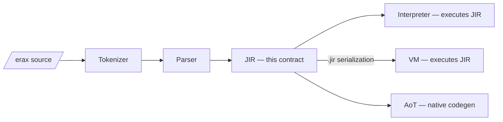

# Middleend — JIR (v0.1)

JIR is the single middle-end IR of erax: what the parser emits and what every backend executes. One program shape, virtual registers, no allocated form.



Interpreter and VM are the **same execution engine** over virtual-register JIR — the interpreter runs it in-process (text → JIR → execute), the VM runs it from a serialized `.jir` file. AoT lowers JIR to native code; how it does that is a backend concern, not part of this contract.

## Scope

| v0.1                                                  | Later                                                                        |
| ----------------------------------------------------- | ----------------------------------------------------------------------------- |
| Functions, globals, integer types                     | Floats                                                                         |
| Arithmetic, comparisons, calls, control flow          | Strings — `std.string` in the stdlib, a heap pointer wrapper; **no string ops in JIR, ever** |
| By-value only — no pointers, no arrays                | Pointers/arrays (what `std.string` is built on)                                |
|                                                       | Closures, objects/classes, stdlib + externs (`std.print`), imports, optimization passes |

## Structure

```cpp
namespace erax::ir {

enum class Type { Void, I8, U8, I16, U16, I32, U32, I64, U64 };

enum class OperandKind { Instant, VReg, Global, Fn };

struct Operand {
    OperandKind kind;  // what the number means
    Type type;         // written at construction — the IR is self-describing
    u64 value;         // integer literal | vreg id | global id | function id
};

struct Command {
    Operation op;
    std::vector<Operand> args;  // one shape for every op; roles from the op table
};

struct Function {
    Declaration decl;                // id + return type
    std::vector<Declaration> params; // the leading vregs of this function's run, in order
    CFG cfg;                         // entry block is 0
};

struct Global {
    Declaration decl;
    CFG init_cfg;  // empty = zero initializer
};

struct Program {
    std::vector<Function> functions;
    std::vector<Global> globals;
    u64 entrypoint;  // function id: zero params, returns i32
};

}  // namespace erax::ir
```

- All collections are **ordered vectors** — deterministic iteration.
- Print form: instant = bare integer, vreg = `$<id>`, global = `@<id>`, function = `&<id>`, and the [VOID sentinel](#virtual-registers) renders as `VOID`. Examples write each operand as `type value` (e.g. `i32 $3`, `u8 1`) and use names where it reads better.
- An operand's value is a **number and nothing else**. What the number means is the kind; its meaning is fully given by the operand itself — every backend reads the type from the bytes, nothing is resolved at load or execution time.
- `Fn` operands (`&<id>`) carry the function's return type; `Global` (`@<id>`) carries the global's type.

## The one shape

Every command is `OP arg0 arg1 …`. The op table decides what each position means — there is **no fixed `dst` field**. An op that produces a result puts it in `args[0]`; an op that doesn't simply has no result slot. `MOV i32 $d i32 5` stores into `$d`, `RET` has no destination at all. One shape, roles from the table, no per-op exceptions.

## Types

| Type           | Size | Notes                           |
| -------------- | ---- | ------------------------------- |
| `void`         | 0    |                                 |
| `i8` `u8`      | 1    | `bool`/`char` lower to `i8`     |
| `i16` `u16`    | 2    |                                 |
| `i32` `u32`    | 4    |                                 |
| `i64` `u64`    | 8    |                                 |

Every operand carries its own type, written when the JIR is built — an `Instant` says its type explicitly (`i32 5`, `u8 7`), a `VReg` operand carries that vreg's type, and a `Fn` operand carries the callee's return type. Commands are therefore complete by themselves: executing `SAR [i32 a, i32 b, i32 3]` needs no lookups, the signedness and width are physically in the operands.

No implicit conversions — operand types must match exactly where the op requires it. The parser/emitter writes consistent types; the validator enforces them.

## Operations

Shapes below are written as `dst a b …` = `args[0] args[1] args[2] …`. Arithmetic ops take `a`, `b`, `dst` of the same integer type unless noted.

### Data movement

| Op    | Shape      | Semantics                                                        |
| ----- | ---------- | ---------------------------------------------------------------- |
| `MOV` | `MOV dst src` | `dst = src` (`src`: instant/vreg/global; `dst`: vreg/global). The only way to read or write a global. |

### Integer arithmetic

Two's-complement, wrapping (see [semantics](#runtime-semantics)). Signedness of div/mod and `SAR` comes from the operand type.

| Op                 | Shape         | Semantics                                          | x64 analog |
| ------------------ | ------------- | -------------------------------------------------- | ---------- |
| `ADD` `SUB` `MUL` | `ADD dst a b` | `dst = a op b` (wrap)                              | `add`/`sub`/`imul` |
| `INC` `DEC`        | `INC dst a`   | `dst = a ± 1` (wrap)                               | `inc`/`dec` |
| `NEG` `NOT`        | `NEG dst a`   | `dst = -a` / bitwise `~a` (wrap)                   | `neg`/`not` |
| `AND` `OR` `XOR`   | `AND dst a b` | bitwise                                            | `and`/`or`/`xor` |
| `SDIV` `SMOD`      | `SDIV dst a b`| signed div/mod, truncate toward zero; divide-by-zero or `iMIN/-1` → process death | `idiv` |
| `UDIV` `UMOD`      | `UDIV dst a b`| unsigned div/mod; divide-by-zero → process death   | `div` |
| `SHL` `SHR` `SAR`  | `SHL dst a b` | shifts; count masked to operand width (see [runtime semantics](#runtime-semantics)); `SHR` logical, `SAR` arithmetic | `shl`/`shr`/`sar` |

### Comparisons

`dst` is always `i8` holding 0/1. Signedness from the operand type.

| Op                                                           | Shape       | Semantics      | x64 analog   |
| ------------------------------------------------------------ | ----------- | -------------- | ------------ |
| `CMP_EQ` `CMP_NE` `CMP_LT` `CMP_LE` `CMP_GT` `CMP_GE`       | `CMP_EQ dst a b` | `dst = (a op b)` | `cmp` + `setcc` |

Logical negation is `CMP_NE $dst $a 0`.

### Control

| Op     | Shape                                   | Semantics                                                   | x64 analog |
| ------ | --------------------------------------- | ----------------------------------------------------------- | ---------- |
| `CALL` | `CALL dst &f a0 … an-1` | Call `f`, pass `a0..an-1` as its params in order; result → `dst`. A void callee is signaled by `dst` being the `VOID` sentinel: `CALL VOID &f a0 …`. | `call` |
| `RET`  | `RET src` (non-void) / `RET` (void)     | Terminator: return `src` / nothing. A `RET` block has no edges | `ret` |

`CALL` is not a special case — the callee (`&f`) is just `args[1]`, the result slot is `args[0]` (the `VOID` sentinel for void calls), and the arguments follow at `args[2..]`. Decoding a `CALL` never depends on the callee's signature; the *call itself* declares the shape. There are **no jump ops**; all branch flow lives on the CFG edges.

## Control flow

A function body (and a global initializer) is a **CFG**:

1. **Nodes** are basic blocks — an ordered list of JIR commands, plus metainfo (allocation data and the like will live here later). Node `0` is the entry.
2. **Edges** decide flow between blocks. Every node has **0 to 2 outgoing edges**:
   - `0` — the block ends in `RET`;
   - `1` — unconditional;
   - `2` — a branch: one edge carries a `Condition`, the other is the fallthrough.

```cpp
struct Condition { Operation cmp; Operand a, b; };  // cmp ∈ CMP_EQ…CMP_GE

struct Node {
    std::vector<Command> code;
    // block metainfo will live here later
};

struct Edge {
    u64 from;
    u64 to;
    std::optional<Condition> cond;  // set only on the conditional edge of a branch
};

struct CFG {
    std::vector<Node> nodes;  // entry is node 0
    std::vector<Edge> edges;
};
```

Execution: run a block's commands in order, then follow its exit — the single edge if it has one; with two, the edge whose `Condition` holds, else the fallthrough. An edge's `Condition` is one of the comparison ops on two operands — e.g. "`x` is nonzero" is `(CMP_NE, x, 0)`.

## Virtual registers

- **One global namespace.** VReg ids are unique program-wide; each function owns a **contiguous run of ids**, its params in the run's leading slots. Once `&1` takes `$2..$3`, the next function takes the next ids — `&2` owns `$4..$5`, `&3` owns `$6..$8`, … — and no function ever touches another's run. Every function's frame size is therefore a compile-time constant.
- **A stack of frames.** A function's run describes *one frame*. Every `CALL` pushes a fresh frame sized to the callee's run and copies the arguments into its leading slots; `RET` pops it. Recursion and mutual recursion are ordinary calls — each invocation reads its own frame. Where frames live (memory stack, heap, fully inlined) is a backend choice.
- **The `VOID` sentinel.** `Operand{VReg, Void, u64(-1)}` is a phantom vreg that names "no slot". As a `CALL` result it means "this callee returns nothing, discard". It may appear *only* there — the validator rejects it anywhere else.
- **Reaching definitions** is the whole discipline (deliberately non-SSA, no phis): a vreg read in a block must be defined on *every* path from entry to it. Params and globals count as defined at entry. The `VOID` sentinel takes no part in definitions.
- Every expression temporary is a fresh vreg; a named local is one vreg, writable many times.

## Calls

`CALL` is defined by what it produces, not by how a backend runs it.

> Executing `CALL [$d &f $a0 … $an-1]` behaves exactly as if `f`'s CFG were pasted in place with fresh (stacked) frames: `$a0..$an-1` fill `f`'s params in order, its other vregs are a fresh frame, and when it reaches `RET`, the returned value is written to `$d`. A void call writes the `VOID` sentinel instead of `$d`: `CALL [VOID &f $a0 …]` — no value comes back.
> A backend may implement this as a real stack frame or full inlining — the contract is only that the observable result matches.

The caller's argument vregs are untouched (the callee reads copies of the values). Argument order is the written order, so reordering is free.

**Worked example.** `fn add3(x: i32, y: i32, z: i32): i32 = x + y + z`; in `main`, `a=$0`, `b=$1`, `c=$2`:

```
CALL [i32 $3, &add3, i32 $1, i32 1, i32 $0]   ; r = add3(b, 1, a) — arg types are on the call
```

A void call — say a helper `log(x: i32)` with no return value — states its own shape with the sentinel:

```
CALL [VOID &log, i32 $3]                      ; VOID dst — no value comes back; &log must return void
```

**Entrypoint**: `Program::entrypoint` — zero params, returns `i32`. No arguments in, process exit code out.

## Globals

1. Every global is **zero-initialized**.
2. Each `Global::init_cfg` (non-empty) runs in **declaration order** — a normal CFG (entry 0, zero params, globals pre-defined).
3. Then the entrypoint runs.

An empty init CFG means step 1 already did the job.

## Runtime semantics

Cross-backend invariants. Every value in this contract is either defined here or a validator error — there is no undefined behavior.

- **Overflow wraps** (two's complement): `i64max + 1 = i64min`. No trap, no cost.
- **Divide-by-zero = process death** (x64 `#DE`; interpreter/VM abort without unwinding). `iMIN / -1` dies too, matching `idiv`.
- **Div/mod truncate toward zero**, signed and unsigned.
- **Shift counts wrap to the operand width.** A count is taken modulo the width: `count & (width-1)`, i.e. `i8`/`u8` → 3 bits, `i16`/`u16` → 4, `i32`/`u32` → 5, `i64`/`u64` → 6. Every shift is thus defined for *any* count — no unspecified behavior — and identical on every backend. The mask is architecture-neutral on purpose: on x64 a variable sub-64-bit shift needs one extra `and` (constant counts fold away), and 64-bit shifts match the hardware mask exactly.
- **Signedness**: signed for `i*`, unsigned for `u*` (comparisons, div/mod, `SAR`).
- **Bool**: `i8` 0/1; a condition is always a `(cmp, a, b)` pair, with C's "nonzero" rule.
- **Determinism**: ordered IR, single-threaded. The same program has the same observable behavior (final global state + entrypoint return) on every backend.

## Backends

| Backend     | Input           | Notes                                                                                |
| ----------- | --------------- | ------------------------------------------------------------------------------------ |
| Interpreter | JIR, in-process | A call frame is a plain array sized to the callee's vreg run, addressed by the local index (global id minus the run's base); `CALL` pushes a fresh frame and copies the arguments into the leading slots. |
| VM          | `.jir` file     | The same engine, same frame semantics, running from a file. No JIT — the file *is* the program. |
| AoT         | JIR → native    | Codegen concerns (instruction selection, frame layout, register allocation) are backend-internal and not part of this contract. |

**Serialization**: `.jir` = magic + `u32` version (v0.1: 1) + deterministic little-endian encoding of `Program` (commands as op + operand list; arity from the op table). The op table is frozen by the format — a new op is a version bump.

## Validator

Runs on every `Program` before any backend sees it:

1. Entry block is 0; every block reachable; every edge's `from`/`to` valid; 0–2 outgoing edges per block; a two-edge block has exactly one conditional edge; a block has no outgoing edges iff it ends in `RET`; no jumps as ops.
2. Commands: arity and operand roles match the op table; operand types are the explicit ones on each operand; ops requiring same-type operands get them, no implicit conversions.
3. Definitions: every vreg read has a reaching definition from entry; every vreg has one consistent type across all its reads and writes.
4. Calls: `args[1]` is the callee — a `Fn` operand naming a valid function — and `args[2..]` the arguments: count equals the callee's param count, arg types match, every arg vreg is defined. `args[0]` is the result slot: the `VOID` sentinel iff the callee returns void — a sentinel anywhere else is an error, and a non-void `dst` must match the callee's return type.
5. Program: entrypoint exists, zero params, `i32` return.
6. Init CFGs: the same rules as function CFGs, zero params.

## Not in v0.1

- Floats — they will reuse the same operand `u64`: an `f64` is its 8-byte bit pattern, reinterpreted by type. No format change.
- Pointers/arrays — with them comes `std.string` in the stdlib; strings stay library-level, JIR gets no string ops.
- Stdlib + externs (`std.print`), then imports.
- Closures, objects/classes.
- AoT codegen concerns — optimization passes, physical register allocation, frame layout. These are backend work, tracked here only because the AoT row expects them eventually.